<p align="center">
  
</p>

<p align="center">
  <a href="https://prompt-pipeline.io"><b>Website</b></a> ·
  <a href="#4-check-it-yourself"><b>Verify a site</b></a> ·
  <a href="#use-it-in-your-project"><b>Use it</b></a> ·
  <a href="docs/"><b>Docs</b></a>
</p>

<p align="center">
  <a href="https://github.com/titouannwtt/prompt-pipeline-core/releases/latest"></a>
  <a href="LICENSE"></a>
</p>

The encryption module of [Prompt Pipeline](https://prompt-pipeline.io), published so that **anyone can check that the
site runs exactly this code**, and reuse it in their own project. Your data is encrypted in your browser, with a key
derived from a passphrase that never leaves it. The site serves this module byte for byte, and you can compare its
fingerprint with the one published here.

## 1. On most sites



HTTPS protects the trip only. After that, the server, the database, the backups and the people who run them can read your data.

## 2. With prompt-pipeline-core



Every record is encrypted in your browser (AES-256-GCM) before it is saved locally or synced. The sync server only
stores ciphertext. Connectors (SSH, AI, FTP) are separate: their content crosses a stateless relay to the destination
you chose, and is never stored.

## 3. The keys stay with you



Your passphrase goes through Argon2id and becomes a non-extractable key that stays on your device. In Sovereign mode
nobody else holds anything that can decrypt. In Managed mode, a wrapped copy of the key is kept so the account can be
recovered, which means the operator **can** decrypt. The app shows which mode you are in.

## 4. Check it yourself



```sh
npx github:titouannwtt/prompt-pipeline-core verify https://prompt-pipeline.io
```

The command runs outside the page, so the site cannot influence it: it downloads the files the site serves, hashes
them and compares them with `releases/<version>/SHA256SUMS` in this repository. To go further, rebuild with
`npm ci && npm run build` and compare `dist/SHA256SUMS`. Details: [docs/verify.md](docs/verify.md).

> [!IMPORTANT]
> **What this does not prove.** Prompt Pipeline's application is private: it could in theory send plaintext
> elsewhere. Check that by behaviour (developer tools, network tab: the passphrase never appears in a request, only
> ciphertext goes to storage). A check holds for the session you made it in. Full list: [docs/threat-model.md](docs/threat-model.md).

## Use it in your project

1. Install: `npm i github:titouannwtt/prompt-pipeline-core#v<version>` (see the latest release above). `dist/` is built on install.
2. Serve `dist/prompt-pipeline-core.js` and `dist/argon2.worker.js` **unchanged** under `/core/<version>/`, and import them from there.
3. Publish `/.well-known/prompt-pipeline-core.json`. Your users can now run the same `verify` command on your site.

A working page is in [`examples/minimal`](examples/minimal). Integration guide: [docs/integration.md](docs/integration.md) ·
API: [docs/api.md](docs/api.md) · Build and releases: [docs/build-and-releases.md](docs/build-and-releases.md).

---

Apache-2.0, see [LICENSE](LICENSE) and [NOTICE](NOTICE). Built by [titouannwtt](https://github.com/titouannwtt) for [prompt-pipeline.io](https://prompt-pipeline.io).
